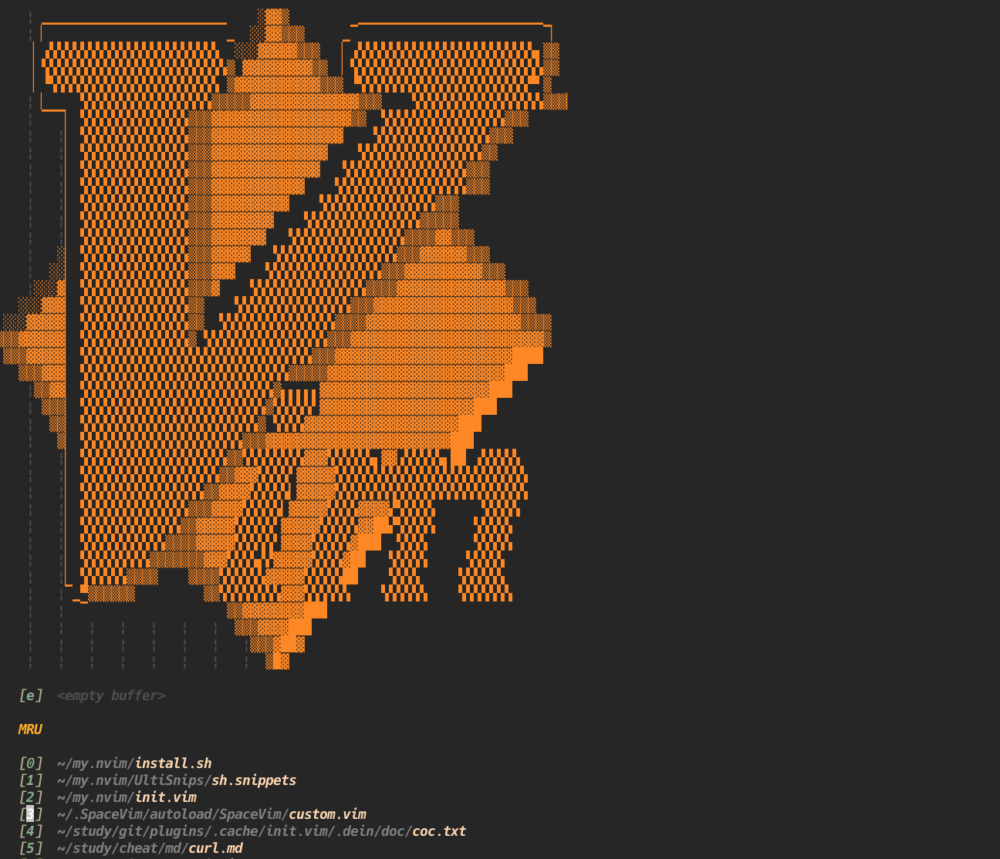
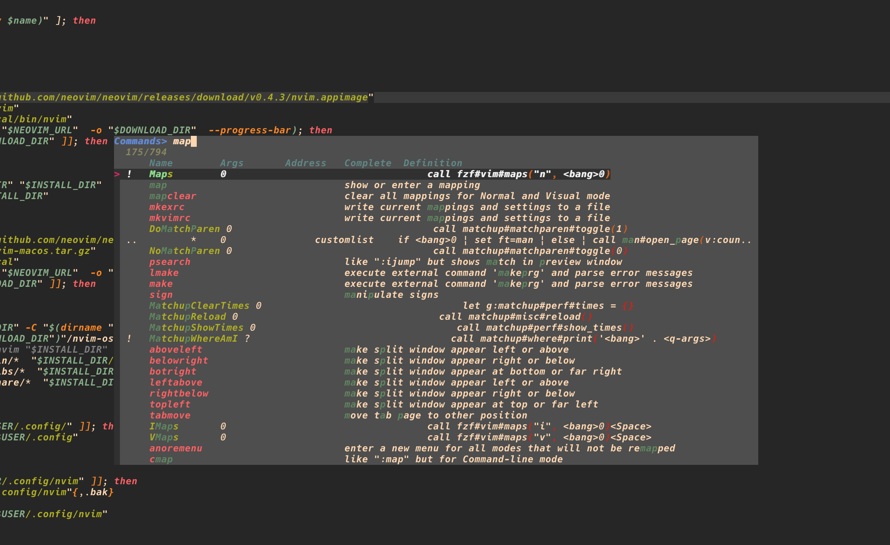
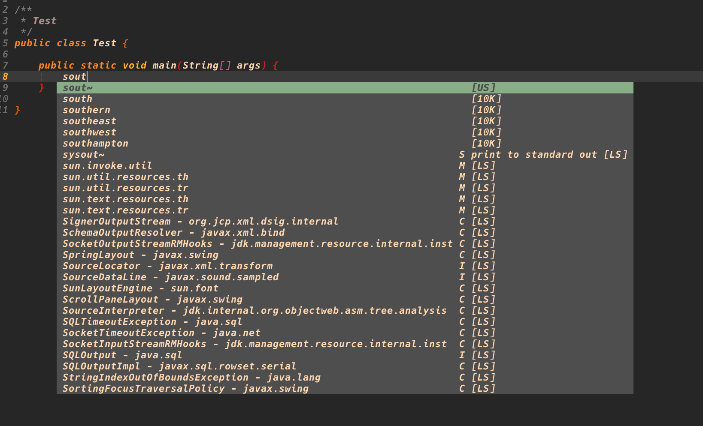
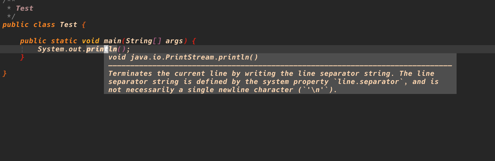

# 仿VsCode的Vim配置

## 简介

使用最新的neovim，仿照VsCode的操作方式，使用coc.nvim提供强大的补全功能。

## 远程 Neovim 试用

已接入 [remote-nvim.nvim](https://github.com/amitds1997/remote-nvim.nvim)：
远端运行完整配置和插件，本地显示远端界面。该上游已归档，此处固定到指定提交用于试用。

1. 重新打开本地 `nvim`，执行 `:RemoteStart`，或按 `<Space>rs`。
2. 在选择器中选择 SSH 主机；首次连接按照提示选择远端目录和 Neovim。
   此配置需要 Neovim **0.11+**，优先使用与本地相同的版本。
3. 配置会复制到插件管理的远端目录，使用 `NVIM_APPNAME=mynvim-remote`。
   原有 LSP、Git、搜索等插件完整加载；插件和工具在远端安装，首次启动需要联网。
4. `<Space>ri` / `:RemoteInfo` 查看进度，`:RemoteLog` 查看错误。
   如首次安装尚未完成，等待 `:Lazy` 中的安装结束后重新连接。

本地 Neovim 配置目录的软链接会先解析为真实路径。仅同步配置，
不上传本地插件二进制、Mason 工具或缓存。远端需要 Git，以及对应插件使用的
`rg`、Node.js、编译器等；这些依赖不会由 rnvim 的旧安装器提供。

启动连接的本地 Neovim 必须保持运行；关闭它会停止上游插件启动的远端服务。
远端 `:qa` 也会结束会话。这用于体验完整远端插件生态，不等同于独立常驻运行时。

旧方案仍可通过 shell 的 `rnvim host:path` 或本地 `:RnvimConnect` 使用。

## 界面截图

## 依赖

+ fzf: 最重要的组件，提供搜索列表等功能
+ Ag， Rg: 提供模糊搜索功能
+ node,yarn: coc.nvim依赖node来运行，可能要使用yarn进行构建

## 安装

### 手动安装

1. 手动安装rg
2. 安装4.0以上的neovim
3. 将本配置文件clone到~/.confg/nvim中
4. 手动clone dein和dein-ui项目并手动修改配置文件里面的DEIN,PLUGINS路径
5. 打开neovim，等待自动安装插件完成。这一步可能会花一些时间

### 脚本安装

**注意安装脚本没有完全测试过，所以目前还是建议你手动进行安装，如果你还是想要使用脚本安装的话，请在执行之前最好先读一下脚本!**

`curl -fsSL https://raw.githubusercontent.com/beardnick/my.nvim/master/install.sh | bash`

## 其它注意事项

1. coc.nvim安装出问题: 尝试 `:call coc#util#install()`
2. coc必装插件: coc-git, coc-explorer, coc-pairs. 其他语言类插件如:coc-java, coc-python
3. 查看keymap: `:Verbose map` 或者 `:Maps`

